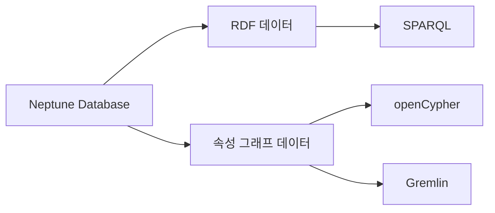
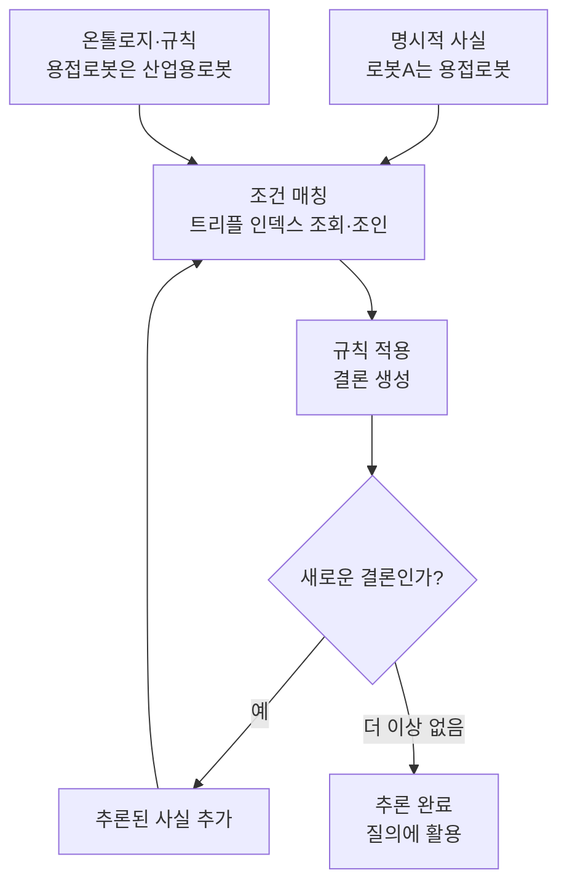
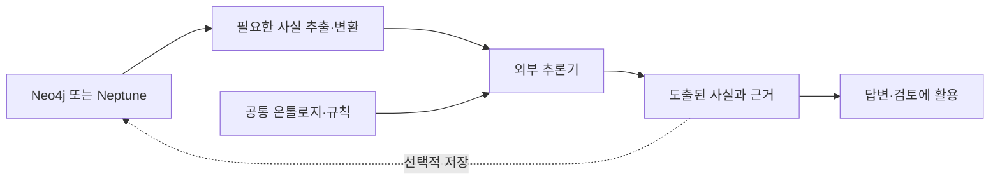
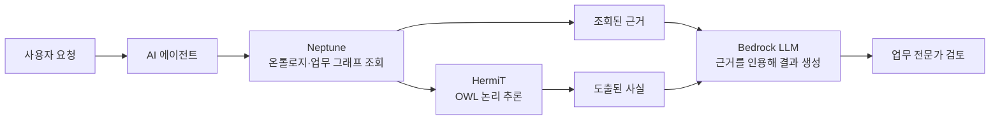
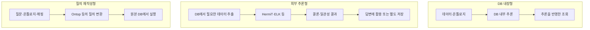
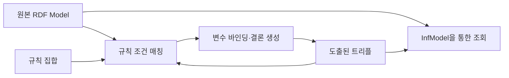
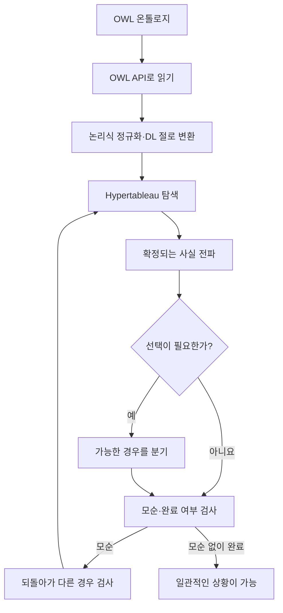
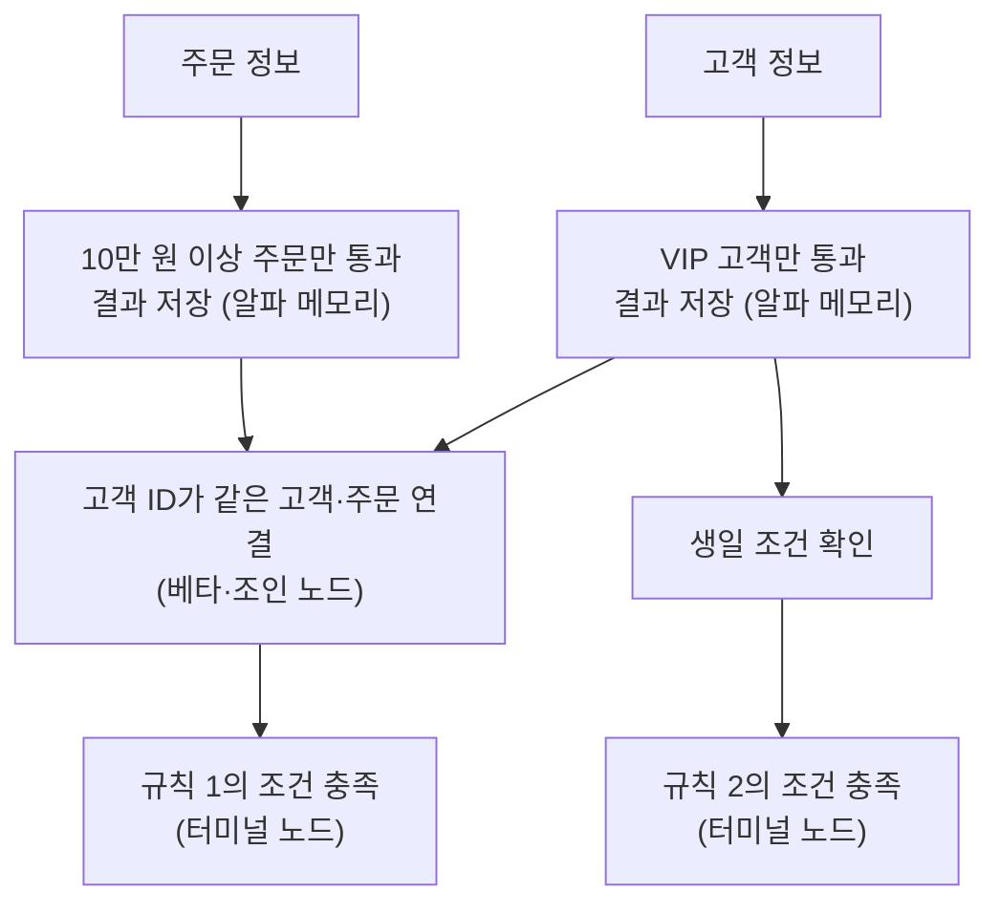

그래프 데이터베이스(Amazon Neptune, Virtuoso, Blazegraph, Ontotext GraphDB, Neo4j)와 온톨로지·규칙 추론기(HermiT, ELK, Pellet/Openllet, RDFox, Apache Jena, RDFLib `owlrl`, Ontop, Nemo, Soufflé)의 구조적 차이를 정리한 기술 노트다. 추론(Reasoning)과 SHACL 검증의 역할 분담, AWS의 최근 온톨로지 아키텍처(MUFG 사례 및 Context Ontology Accelerator), RETE(Forgy, 1982)와 Hypertableau(Motik et al., 2009) 원 논문의 핵심 알고리즘, HermiT의 Java 구현 구조, 그리고 오픈소스 생태계 현황과 교차 비교 실험 설계까지 빠짐없이 다룬다.

---

## 1. Amazon Neptune의 구조와 기존 RDF DB 비교

**[Amazon Neptune](https://docs.aws.amazon.com/neptune/latest/userguide/intro.html)**은 AWS가 운영을 관리해 주는 그래프 데이터베이스다. 기업·부품·문서 같은 대상과 그 사이의 관계를 저장하고, 연결을 따라 데이터를 찾는 데 사용한다. 백업·복구·복제 같은 운영 기능도 제공한다.

예를 들어 다음과 같은 구조의 자료를 저장하고 탐색한다.

```text
작업 기록 ──설정 참조──▶ 설정표 ──명목 전류──▶ 450 A
    │
    └──결함 코드 참조──▶ 결함 사전
```

기존에 Virtuoso, Blazegraph, Ontotext GraphDB 같은 RDF·SPARQL 계열 제품을 사용했다면 Neptune도 RDF·SPARQL 방식으로 시작할 때 꽤 익숙하다. 새로 익힐 부분은 주로 AWS 운영 방식과 **추론·SHACL 검증 기능을 어디에 배치하느냐**, 그리고 **쿼리 언어와 운영 방식이 어떻게 다른지**다.

| 제품 | 중심 성격 | Neptune과 비교하면 |
|---|---|---|
| **Virtuoso** | SQL과 RDF를 함께 다루는 멀티모델 DB. 관계형 데이터의 RDF 뷰·가상화도 제공 | SQL/RDF 통합이라는 성격이 강함. Neptune을 Virtuoso의 SQL·가상화 기능까지 대체하는 제품으로 보면 안 됨 |
| **Blazegraph** | RDF 트리플·쿼드 저장과 SPARQL 중심 엔진 | RDF 적재 → SPARQL 조회 경험은 유사함. 서버 운영과 제품별 확장 기능에서 차이 |
| **Ontotext GraphDB** | RDF 저장·SPARQL에 규칙 추론과 SHACL 검증을 통합 | 온톨로지·규칙·검증을 DB 안에서 다루는 경험이 강함 |
| **Amazon Neptune Database** | AWS가 운영하는 관리형 그래프 DB. RDF와 속성 그래프 지원 | 백업·복제·가용성 등 인프라 운영을 맡기고, 애플리케이션·권한·네트워크·비용을 설계하는 방식 |

제품 성격은 [Virtuoso 공식 소개](https://www.openlinksw.com/virtuoso/), [Blazegraph 저장소](https://github.com/blazegraph/database), [GraphDB 문서](https://graphdb.ontotext.com/documentation/11.0/reasoning.html), [Neptune FAQ](https://aws.amazon.com/neptune/faqs/) 기준이며, 세부 기능은 버전·에디션·설정에 따라 다르다.

### 1.1 데이터 모델과 쿼리 언어 연결

Neptune에서는 SPARQL을 계속 써도 된다. Neptune의 데이터 모델과 쿼리 언어는 다음과 같이 연결된다([AWS 쿼리 문서](https://docs.aws.amazon.com/neptune/latest/userguide/access-graph.html)).



- **RDF**: 익숙한 IRI·트리플·네임드 그래프를 SPARQL로 조회한다.
- **속성 그래프**: 노드·엣지·속성을 openCypher 또는 Gremlin으로 조회한다.
- openCypher와 Gremlin은 같은 속성 그래프를 조회할 수 있다. 그러나 **RDF로 넣은 데이터를 곧바로 Cypher로 조회하는 구조는 아니다.** 두 모델 사이에는 명시적인 변환·적재 설계가 필요하다.

예를 들어 RDF에 저장한 직접 모회사 관계는 그대로 다음과 같이 조회한다(설명용 예시).

```sparql
PREFIX ex: <https://example.org/>

SELECT ?parent WHERE {
  ex:CompanyA ex:directParent ?parent .
}
```

속성 그래프로 모델링했다면 같은 의도의 질의를 다음과 같이 표현할 수 있다.

```cypher
MATCH (:Company {id: 'CompanyA'})-[:DIRECT_PARENT]->(p:Company)
RETURN p.id
```

다만 Neptune의 openCypher 지원이 Neo4j 전체 기능을 뜻하지는 않는다. APOC 같은 Neo4j 확장은 그대로 가져올 수 없다([호환성 문서](https://docs.aws.amazon.com/neptune/latest/userguide/migration-compatibility.html)).

### 1.2 저장·질의와 추론·검증의 결합 방식 차이

GraphDB를 써봤다면 가장 중요한 차이는 **‘저장·질의’와 ‘추론·검증’의 결합 방식**이다.

GraphDB에서는 규칙 집합(ruleset)을 지정해 추론하고, SHACL을 켜서 데이터 변경을 검증하는 흐름이 제품에 통합돼 있다([GraphDB 추론](https://graphdb.ontotext.com/documentation/11.0/reasoning.html) · [SHACL 검증](https://graphdb.ontotext.com/documentation/11.0/shacl-validation.html)). Virtuoso에도 추론 컨텍스트를 지정하는 기능이 있고([Virtuoso 추론 설정](https://docs.openlinksw.com/virtuoso/rdfsparqlrule/)), Blazegraph에도 RDFS와 일부 OWL을 포함하는 추론 기능이 있다([Blazegraph 추론 문서](https://github.com/blazegraph/database/wiki/InferenceAndTruthMaintenance)). 다만 Blazegraph는 기본 제공 추론이 쿼드 모드에서는 지원되지 않는 등 조건이 있다. 같은 RDF를 적재했다고 네 DB가 같은 추론 결과를 내는 것은 아니다.

Neptune을 사용할 때는 GraphDB에서 쓰던 추론·SHACL 설정이 그대로 따라온다고 생각하면 안 된다. 연구 파이프라인에서는 다음과 같이 분리하면 된다.

```text
Neptune에서 근거 조회
        ↓
조회한 근거를 고정
        ├─ LLM 초안·자체 검토
        └─ 외부 pySHACL 검증 → 검토 보고서
                                  ↓
                       LLM 수정·사람 검토 지원
```

AWS의 참조 아키텍처도 Neptune을 저장소로 두고, OWL 추론기와 SHACL 검증기는 별도 서비스로 구성하는 방식을 제시한다([AWS 아키텍처 설명](https://aws.amazon.com/blogs/database/build-an-ontology-driven-semantic-layer-with-amazon-neptune/)).

이 구조는 **“SHACL은 마지막이나 중간 검토 단계에서 확인 자료로 사용하자”**는 방향과 잘 맞는다. 검증 위반이 나왔다고 답변을 무조건 막을 필요는 없고, 어떤 근거·조건을 사람이 확인해야 하는지 보고서로 전달할 수 있다.

### 1.3 내부 쿼드 인덱스 구조와 Neptune Analytics 구분

내부 엔진 관점에서는 Neptune도 인덱스를 통해 그래프 패턴을 찾는 DB다.

Neptune은 내부 기본 저장 단위로 `Subject–Predicate–Object–Graph` 네 위치의 쿼드(Quad)를 사용하고, 기본적으로 `SPOG`, `POGS`, `GPSO` 인덱스를 유지한다([데이터 모델](https://docs.aws.amazon.com/neptune/latest/userguide/feature-overview-data-model.html) · [인덱스 구조](https://docs.aws.amazon.com/neptune/latest/userguide/feature-overview-data-model.html#feature-overview-data-model-indices)). RDF와 속성 그래프를 이 내부 구조로 표현하지만, 그것이 두 모델의 자동 상호 변환을 의미하지는 않는다. 또한 이 구조만으로 Virtuoso·Blazegraph보다 빠르다고 말할 수는 없고, 실제 질의와 데이터로 비교해야 한다.

이름이 비슷한 **[Neptune Analytics](https://aws.amazon.com/neptune/analytics/)**는 별도 서비스다. 메모리 중심 그래프 분석, 그래프 알고리즘, 벡터 검색 등을 제공하는 쪽이고, 저장·조회용으로 먼저 붙이는 **Neptune Database**와 구분해야 한다.

연구 실험에서 Neptune을 추가하는 의미는 **“더 좋은 온톨로지 추론기를 도입한다”보다 “같은 근거 조회를 실제 AWS 관리형 그래프 DB에서도 구현하고 비교한다”**에 가깝다. 따라서 DB별 조회 결과·지연·비용 비교와, SHACL 보고서가 LLM 답변에 주는 효과는 분리해서 측정하는 것이 맞다.

---

## 2. RDF·OWL 추론기의 내부 구조와 SHACL 검증의 차이

여기서 말하는 **추론기(reasoner)는 ‘저장된 사실과 명시된 규칙을 조합해서, 직접 적지 않은 결론을 계산하는 소프트웨어’**다. GraphDB에서 설정하는 `RDFS`, `OWL-Horst`, `OWL2-RL` 같은 ruleset이 바로 어떤 범위의 추론을 할지 정하는 설정이다([GraphDB 추론 문서](https://graphdb.ontotext.com/documentation/11.0/reasoning.html)).

예를 들어 다음 두 문장이 있다고 하자.

```turtle
ex:용접로봇 rdfs:subClassOf ex:산업용로봇 .
ex:로봇A   rdf:type        ex:용접로봇 .
```

추론기는 하위 클래스(`rdfs:subClassOf`)의 의미를 적용해서 다음 사실을 도출한다.

```turtle
ex:로봇A   rdf:type        ex:산업용로봇 .
```

이제 “산업용 로봇을 찾아줘”라는 질의에 `로봇A`도 포함할 수 있다. 새로운 관측 사실을 발견한 것이 아니라, 주어진 사실에 이미 함축된 내용을 꺼낸 것이다.

### 2.1 추론기의 4대 기능과 프로파일

기능은 크게 네 가지로 생각하면 된다. 실제 지원 범위는 추론기와 선택한 논리 프로파일에 따라 달라진다.

| 기능 | 예시 |
|---|---|
| **타입·분류 도출** | 용접로봇인 A는 산업용로봇이기도 함 |
| **관계 도출** | `hasPart`와 `partOf`가 역관계라면, A가 B를 포함할 때 B는 A의 일부 |
| **클래스 계층 계산** | 클래스 정의를 분석해 어떤 클래스가 다른 클래스에 포함되는지 계산 |
| **논리적 모순 탐지** | 서로 겹칠 수 없다고 선언한 두 클래스에 같은 개체가 속하는지 확인 |

예를 들어 관계의 전이성(transitivity)을 선언하면 `A → B`, `B → C`에서 `A → C`를 도출할 수도 있다. 다만 모든 관계가 전이적인 것은 아니므로, ‘직접 모회사’ 같은 관계에 무턱대고 적용하면 의미가 잘못된다. 추론기가 지원하는 표현력과 계산 방식에는 OWL EL·QL·RL 같은 구분이 있다([W3C OWL 프로파일](https://www.w3.org/TR/owl2-profiles/)).

### 2.2 규칙 기반 전방 추론기의 내부 흐름과 삭제(철회) 관리

내부 구조는 GraphDB 같은 규칙 기반 전방 추론기(forward-chaining reasoner)를 보면 이해하기 쉽다.



구성 요소를 풀면 다음과 같다.

1. **사실 저장소**: 입력 데이터와 도출된 데이터를 보관한다.
2. **규칙 처리부**: 온톨로지의 의미를 실행할 수 있는 규칙으로 준비한다.
3. **매칭·실행부**: 규칙의 조건에 맞는 트리플을 찾아 결론을 생성한다.
4. **중복·변경 관리부**: 같은 결론을 반복해서 추가하지 않고, 원본 변경에 따라 결과를 갱신한다.

여기서 까다로운 부분은 **삭제(retraction)**다. “A는 산업용로봇”이라는 결론에 근거가 두 개 있다면, 하나를 삭제했다고 결론까지 지우면 안 된다. 그래서 근거 의존성을 관리하거나 관련 추론을 다시 계산해야 한다. GraphDB도 명시적 사실의 삭제와 재추론을 다룬다([GraphDB 추론·철회 설명](https://graphdb.ontotext.com/documentation/11.0/reasoning.html#retraction-of-assertions)).

모든 추론기가 이처럼 결과를 미리 저장하는 것은 아니다.

| 구현 방식 | 동작 | 비용이 주로 드는 시점 |
|---|---|---|
| **전방 추론·물질화 (Materialization)** | 규칙을 적용해 결론을 미리 계산·저장 | 적재·변경할 때, 추가 저장공간 |
| **후방 추론·질의 재작성 (Query Rewriting)** | 질문을 받으면 필요한 근거를 찾거나 질의를 확장 | 질의할 때 |
| **논리적 만족 가능성 검사 (Satisfiability)** | 주어진 공리들이 함께 성립 가능한지 탐색 | 복잡한 분류·일관성 검사 때 |

### 2.3 추론과 SHACL 검증의 차이

SHACL과의 차이는 **‘무엇을 출력하느냐’**를 보면 명확하다.

| 구분 | 추론 (Reasoning) | SHACL 검증 (Validation) |
|---|---|---|
| **핵심 질문** | “이 사실과 공리에서 무엇이 따라오는가?” | “이 데이터가 선언한 조건을 만족하는가?” |
| **예시** | A는 용접로봇이므로 산업용로봇 | 로봇 A에 필수 검사일이 누락됨 |
| **주된 출력** | 도출된 사실·분류·일관성 판단 | 적합 여부·위반 위치·검증 보고서 |

SHACL은 데이터 그래프를 shapes에 적힌 조건과 비교하는 표준이다([W3C SHACL](https://www.w3.org/TR/shacl/)). 추론과 함께 사용할 수 있지만, 검증 자체가 누락된 사실을 알아내서 채워주는 것은 아니다.

또 **“모순이 없다”와 “데이터가 완전하다”는 다르다.** OWL에서는 일반적으로 적혀 있지 않은 사실을 곧바로 거짓으로 취급하지 않는다(열린 세계 가정, OWA). 검사일이 없다는 이유만으로 논리적 모순이 생기지는 않지만, SHACL에 “검사일이 최소 하나 있어야 한다(`sh:minCount 1`)”를 선언하면 누락을 보고할 수 있다.

연구 파이프라인에서는 세 역할을 다음과 같이 나누면 된다.

- **추론기**: 명시적으로 합의한 의미·규칙에서 추가 관계나 분류를 계산.
- **SHACL**: 선택한 근거의 누락·형식·관계 조건 등을 점검해 보고서 생성.
- **LLM**: 질문을 해석하고 근거와 보고서를 참고해 답변·검토 사항 작성.

추론 결과도 입력 사실과 규칙이 옳다는 전제 아래의 결론이다. 현실의 진실이나 안전한 조치까지 자동으로 보증하지는 않기 때문에, 최종 검토 용도에서는 “어떤 사실과 규칙으로 이 결론이 나왔는가”를 함께 보여주는 것이 중요하다.

---

## 3. Neo4j(n10s)와 Amazon Neptune의 추론·검증 지원 비교

온톨로지·규칙 추론을 기준으로 보면, **Neo4j**는 플러그인이나 코드로 확장하는 방식이고, **Neptune**은 외부 추론 서비스를 연결하는 방식에 가깝다. 둘 다 GraphDB처럼 ruleset을 선택하면 RDF/OWL 추론이 기본적으로 돌아가는 제품으로 생각하면 안 된다.

| 비교 항목 | Neo4j | Amazon Neptune Database |
|---|---|---|
| **기본 의미 처리** | 노드·관계·속성을 Cypher로 조회. 클래스 상속 등을 자동 적용하지 않음 | RDF/SPARQL 및 속성 그래프 지원. RDF를 저장해도 OWL/RDFS 추론이 자동 실행되지 않음 |
| **기본적인 온톨로지 추론** | neosemantics(`n10s`) 플러그인으로 클래스·속성 계층 등을 활용한 제한적 추론 가능 | AWS 문서상 기본 추론 미지원. 쿼리에 논리를 명시하거나 외부 추론기 사용 |
| **사용자 정의 규칙** | Cypher·프로시저·애플리케이션 코드로 구현 가능 | SPARQL·openCypher·Gremlin 또는 외부 코드로 구현 가능 |
| **복잡한 OWL 추론** | 별도 OWL 추론기와 연동하는 구조 필요 | 별도 OWL 추론기와 연동하는 구조 필요 |
| **SHACL 검증** | `n10s`의 지원 범위 내에서 수행하거나 외부 검증기 사용 | 외부 검증기를 연결하는 구성 |
| **확장 방식의 제약** | `n10s`는 자체 호스팅 Neo4j에서 사용, Aura에서는 사용 불가. 버전 호환성 확인 필요 | 관리형 서비스이므로 DB 내부에 임의의 추론 플러그인을 설치하는 방식이 아님 |

Neo4j의 기본 추론·SHACL 확장은 [n10s 공식 소개](https://neo4j.com/labs/neosemantics/), Neptune의 추론 미지원은 [AWS 호환성 문서](https://docs.aws.amazon.com/neptune/latest/userguide/sparql-standards-compliance.html)에 명시돼 있다.

### 3.1 동일 예제로 보는 4가지 조회 방식

입력된 의미가 다음과 같다고 하자.

```text
용접로봇은 산업용로봇의 하위 클래스다.
로봇 A는 용접로봇이다.

질문: 산업용로봇을 모두 찾아줘.
```

- **Neo4j 기본 조회**: `A`에 `산업용로봇` 라벨이 없다면 단순 라벨 조회로는 나오지 않는다.
- **Neo4j + n10s**: 클래스 계층을 구성하고 추론 프로시저를 호출하면, 하위 클래스에 속하는 `A`까지 조회할 수 있다. 이 방식은 질의 시 계층을 해석하는 것이며, `A`에 새 라벨을 반드시 저장하는 것은 아니다([n10s 추론 예제](https://neo4j.com/labs/neosemantics/4.0/inference/)).
- **Neptune RDF 기본 조회**: `A rdf:type 산업용로봇` 트리플만 찾으면, 그 트리플이 저장돼 있지 않은 `A`는 나오지 않는다.
- **Neptune에서 명시적 계층 조회**: 다음과 같이 SPARQL 경로 표현(`rdf:type/rdfs:subClassOf*`)에 하위 클래스 탐색을 넣어 `A`를 찾도록 구성할 수 있다.

```sparql
SELECT ?robot WHERE {
  ?robot rdf:type/rdfs:subClassOf* ex:산업용로봇 .
}
```

마지막 예시는 해당 클래스 계층에 필요한 논리를 질의에 직접 작성한 것이다. 이것만으로 OWL 전체를 해석하거나 모순을 찾아주는 범용 추론기가 생기는 것은 아니다.

따라서 **‘원하는 결론을 계산할 수 있는가’**와 **‘온톨로지를 읽고 일반적으로 추론해 주는가’**를 구분해야 한다. 예컨대 “부품 X를 사용하는 제품을 찾아 변경 검토 대상으로 표시한다”는 규칙은 두 DB 모두 쿼리와 코드로 구현할 수 있다. 반면 여러 OWL 공리를 읽어 클래스 계층을 계산하고 논리적 모순까지 검사하려면, 지원하는 논리 범위가 명확한 추론기가 필요하다.

### 3.2 외부 추론기 연동 구조와 비교 분리 원칙

외부 추론기를 사용하는 경우에는 두 DB의 구성이 상당히 비슷해진다.



이때 DB 차이보다 어떤 규칙을 주었는지, 어떤 사실을 추론기에 전달했는지, 도출 결과를 언제 갱신하는지가 결과를 크게 좌우한다. AWS도 Neptune과 별도 OWL·SHACL 서비스를 조합하는 아키텍처를 제시한다([AWS 참조 구조](https://aws.amazon.com/blogs/database/build-an-ontology-driven-semantic-layer-with-amazon-neptune/)).

한 가지 용어도 주의해야 한다. **Neptune ML의 `inference`**는 학습 모델(GNN 등)의 예측 실행을 뜻한다([Neptune ML 문서](https://docs.aws.amazon.com/neptune/latest/userguide/machine-learning.html)). 지금 이야기하는 “공리와 규칙에서 논리적 결론을 도출하는 추론”과는 별개다.

연구에서는 먼저 두 DB에 같은 조회·규칙 정책을 적용하는 비교가 적절하다. Neo4j에만 `n10s`를 붙이면 DB와 추론 기능이 동시에 달라져서 결과 차이의 원인을 구분하기 어렵다. 따라서 비교를 다음과 같이 나누면 좋다.

- **DB 비교**: 같은 사실·같은 관계 탐색 → 결과 일치, 지연, 비용 비교.
- **추론 효과 비교**: 같은 근거에 같은 추론기를 적용 → 필요한 결론이 추가되는지 비교.
- **SHACL 검토 효과 비교**: 같은 근거와 답변에 검증 보고서 제공 여부만 변경 → 답변 수정과 검토 도움 측정.

“최종 답변이나 중간 검토 단계에서 SHACL을 활용한다”는 목적에는 Neo4j와 Neptune 중 어느 쪽도 필수 조건이 아니다. 검증 계층을 분리하면 DB를 바꾸더라도 같은 검토 정책을 유지할 수 있다.

---

## 4. AWS의 최근 온톨로지 추론 아키텍처: MUFG 사례와 Context Ontology Accelerator

정확히 정리하면 **“Neptune DB 엔진에 OWL 추론기가 내장돼 있지는 않지만, AWS는 외부 추론기를 결합한 시스템을 적극적으로 제시하고 있다.”**

AWS의 Semantic Layer 설계 문서는 다음과 같이 명시한다([AWS 설계 지침](https://aws.amazon.com/blogs/database/build-an-ontology-driven-semantic-layer-with-amazon-neptune/) · [현재 사용자 가이드](https://docs.aws.amazon.com/neptune/latest/userguide/sparql-standards-compliance.html)).

> “Neptune does not include a built-in OWL reasoner”

온톨로지 추론은 HermiT·Pellet·ELK 같은 외부 엔진에서 실행하거나, 추론된 트리플을 미리 계산해서 Neptune에 적재하라고 안내한다(해당 문서는 기술 비교의 기준 시점을 2026년 5월로 명시). 다만 왜 내장하지 않았는지에 대한 AWS의 공식 의사결정 설명은 공개 문서에 없으므로, “성능 때문에 뺐다”거나 “수요가 없어서 안 만든다”고 단정할 근거는 없다. 확인되는 설계 방향은 **Neptune이 저장·질의를 담당하고, 필요한 추론 엔진을 별도로 선택해서 결합하는 구조**다.

2026년 11월 5일 기준으로 확인한 최근 AWS 자료 중 중요한 것은 다음 네 가지다.

| 날짜 | 자료 | 확인한 내용 |
|---|---|---|
| **2026-10-29** | [Context Ontology Accelerator v0.3.8](https://github.com/aws-samples/context-ontology-accelerator/releases) | 자연어 질의·근거 인용·온톨로지 매핑 관련 개선이 계속되고 있음. Neptune 엔진 자체의 추론 기능 추가는 아님 |
| **2026-10-13** | [Neptune Engine 1.5.0.0](https://docs.aws.amazon.com/neptune/latest/userguide/engine-releases-1.5.0.0.html) | 대량 적재, 저장공간 관리, Gremlin·쿼리 실행 개선. 해당 릴리스에는 OWL 추론기 추가가 기재돼 있지 않음 |
| **2026-10-08** | [MUFG 은행 온톨로지 기반 AI 사례](https://aws.amazon.com/blogs/machine-learning/) | Neptune과 에이전트 사이에 HermiT 추론기를 배치 |
| **2026-07-31** | [Context Ontology Accelerator 공개](https://github.com/aws-samples/context-ontology-accelerator) | AI가 온톨로지를 제안하고 전문가가 검토·승인. Neptune·OpenSearch·Bedrock을 조합 |

### 4.1 MUFG 은행의 Neptune + HermiT + Bedrock 구성

우리 연구와 가장 가까운 사례는 MUFG의 구성이다. 은행 업무 문서를 바탕으로 온톨로지와 지점별 지식 그래프를 만들고, 이를 이용해 업무 흐름도를 생성·비교하는 사례다. AWS가 설명한 요청 처리 구조를 단순화하면 다음과 같다.



게시물은 요청에 필요한 온톨로지와 부분 그래프를 Neptune에서 가져와 HermiT에 전달하고, 도출된 사실을 에이전트가 활용한다고 구체적으로 설명한다. 즉, 여기서 “온톨로지 기반 추론”은 단순 홍보 표현만은 아니고, 별도 논리 추론기가 실제 아키텍처에 들어간다. 다만 이 글은 AWS·고객의 사례 보고이므로, 제목의 작업량 감소 수치를 HermiT 단독 효과나 독립적으로 검증된 일반 성능으로 해석하면 안 된다.

### 4.2 Context Ontology Accelerator와 전문가 협업 흐름

`Context Ontology Accelerator`는 Neptune의 설정 옵션이 아니라 별도로 배포하는 오픈소스 애플리케이션이다. 공식 발표가 설명하는 흐름은 다음과 같다.

```text
구조화·비구조화 데이터 연결
        ↓
AI가 온톨로지 초안 제안
        ↓
도메인 전문가가 검토·수정·승인
        ↓
승인된 온톨로지·지식 그래프 저장
        ↓
MCP를 통해 에이전트에 제공
```

이는 **“결국 도메인 전문가와 AI 전문가가 협업해서 고도화해야 한다”**는 방향과 상당히 가깝다. 공식 발표도 전문가의 검토·승인을 명시한다. 다만 도구가 있다는 사실만으로 자동 생성의 정확성이나 전문가 작업 감소가 검증된 것은 아니다.

### 4.3 ‘추론(Reasoning / Inference)’ 용어 구분과 RDFox 연동 사례

‘추론’이라는 표현이 여러 기능에 쓰여서 혼란이 생기기도 하므로 다음과 같이 구분해야 한다.

| 게시물의 표현 | 실제 의미 | Neptune 내장 OWL 추론인가? |
|---|---|---|
| **Ontology reasoning** | HermiT·RDFox 등이 공리·규칙에서 결론 도출 | 외부 엔진 구성일 수 있음 |
| **Neptune ML inference** | 노드 분류, 수치·관계 예측 등 학습 모델 실행 | 아니요 |
| **GraphRAG reasoning** | 그래프에서 근거를 검색하고 LLM이 답변 생성 | 그 표현만으로 OWL 추론을 뜻하지 않음 |
| **Deep reasoning** | 에이전트가 여러 단계의 질의·도구 호출 수행 | 그 표현만으로 논리 추론기를 뜻하지 않음 |

예를 들어 [Neptune ML의 SPARQL 문서](https://docs.aws.amazon.com/neptune/latest/userguide/machine-learning-sparql.html)는 분류·회귀·주어/목적어 예측을 설명하고, BYOKG GraphRAG 발표는 그래프 질의와 벡터 검색을 결합한 LLM 근거 검색을 설명한다.

참고로 외부 추론기 연동은 최근에 처음 생긴 방식도 아니다. 2023년 AWS의 [Neptune–RDFox 연동 사례](https://aws.amazon.com/blogs/database/reasoning-on-amazon-neptune-using-oxford-semantic-technologies-rdfox/)에서는 Neptune Streams로 변경 데이터를 RDFox에 전달하고, 연합 질의(federated query)로 추론 결과를 함께 조회한다. 최신 사례인 HermiT의 요청별 처리와 달리, 변경 데이터를 따라가는 구성이다.

연구에 적용한다면, Neptune 도입과 추론기 도입을 별도 실험으로 두는 판단은 여전히 유효하며, 다음 조사 대상이 구체화된다.

- **Neptune**: 같은 근거를 저장·조회하는 실제 DB 비교.
- **HermiT 또는 제한된 규칙 추론기**: 조회만으로는 직접 나오지 않는 결론이 필요한 질문에서 추가 효과 평가.
- **SHACL**: 근거·결과의 검토 보고서를 제공했을 때 답변 수정과 사람의 확인에 도움이 되는지 평가.
- **Context Ontology Accelerator**: 자연어·원천 데이터에서 온톨로지를 제안하고 전문가가 수정하는 과정의 참고 구현.

---

## 5. 내장 추론기(Virtuoso·Blazegraph·GraphDB)와 별도 추론 엔진 비교

Virtuoso, Blazegraph, Ontotext GraphDB 모두 자체 추론 기능이 있다. 다만 같은 “추론 지원”이라도, **어떤 논리를 지원하는지**와 **언제 계산하는지**가 상당히 다르다.

먼저 다음 세 가지 구분을 분리해야 한다.

- **내장/외부**: 추론기가 DB 안에 포함돼 있는지, 별도 라이브러리·프로세스로 실행되는지.
- **추론 방식**: 결론을 미리 저장하는지, 질의할 때 계산하는지, 복잡한 논리식의 성립 가능성을 검사하는지.
- **지원 논리**: RDFS, OWL 2 EL·QL·RL·DL, Datalog 등 어떤 언어의 의미를 처리하는지.

예를 들어 **RDFox**는 Neptune에 붙이면 “외부 추론기”지만, 자체적으로는 추론 기능을 내장한 RDF 데이터베이스다. **HermiT**는 DB라기보다 OWL 논리를 계산하는 라이브러리·엔진에 가깝다.

### 5.1 세 RDF DB의 내장 추론 기능 비교

| 제품 | 지원 범위의 중심 | 계산 방식 | 중요한 특성·제약 |
|---|---|---|---|
| **Virtuoso** | 클래스·속성 상속, 동치·동일성, 역관계 등 선택된 RDFS/OWL 기능 | 질의 시 추론 중심. `inference context`를 적용 | 추론 결과를 전부 저장하지 않고 질의에 반영. Open Source와 상용판의 사용자 정의 규칙 지원 범위가 다름 |
| **Blazegraph** | RDFS+와 일부 OWL, 확장 가능한 규칙 | 전방 추론·물질화. 전체 일괄 계산 또는 증분 갱신 | 트리플 모드에서 추론 지원. 쿼드 모드에서는 기본 추론 미지원. 기본 규칙 집합이 OWL 전체나 완전한 표준 프로파일을 뜻하지 않음 |
| **Ontotext GraphDB** | RDFS, OWL-Horst, OWL 2 RL 등 선택 가능한 ruleset과 사용자 정의 규칙 | 전방 추론·전체 물질화 | 적재·갱신 때 결론을 계산하고 조회에 활용. 원본 삭제 시 더 이상 뒷받침되지 않는 추론 결과도 처리 |

출처: [Virtuoso 추론 문서](https://docs.openlinksw.com/virtuoso/rdfsparqlrule/) · [Blazegraph 추론 구조](https://github.com/blazegraph/database/wiki/InferenceAndTruthMaintenance) · [GraphDB 추론 문서](https://graphdb.ontotext.com/documentation/11.0/reasoning.html).

세 제품에서 체감되는 차이를 예로 들면 다음과 같다.

```text
입력: A는 용접로봇이다.
공리: 용접로봇은 산업용로봇이다.

Virtuoso
  → 산업용로봇 조회 시, 추론 컨텍스트를 적용해 A를 포함

Blazegraph·GraphDB의 물질화 방식
  → 적재·추론 과정에서 “A는 산업용로봇”을 계산
  → 이후 조회에서 그 결론을 활용
```

따라서 Virtuoso는 조회 시 필요한 의미를 적용하는 비용, 물질화 방식은 미리 계산하는 비용·추가 저장공간·변경 시 갱신 비용을 고려해야 한다. 어느 방식이 빠른지는 데이터와 질의, 변경 빈도에 따라 달라진다.

특히 Blazegraph 문서는 기본 구성을 “실용적인 규칙 집합”으로 설명하며, 완전한 RDFS나 OWL 2 RL과 같다고 가정하지 말라고 명시한다. GraphDB 역시 ruleset마다 지원 범위가 다르고, OWL 2 QL 구현에는 표준과 다른 부분을 문서화하고 있다.

### 5.2 별도 추론 엔진·라이브러리 7종 비교

| 엔진·도구 | 논리·구현 방식 | 주로 적합한 작업 | 주의할 점 |
|---|---|---|---|
| **[HermiT](http://www.hermit-reasoner.com/)** | OWL 2 DL, hypertableau | 복잡한 클래스 정의, 클래스 포함 관계, 일관성·만족 가능성 검사 | 복잡한 공리 조합의 계산 비용이 클 수 있음. 대규모 트리플 DB의 단순 대체재가 아님 |
| **[Pellet / Openllet](https://github.com/Galigator/openllet)** | OWL DL 계열, tableau 기반. Openllet은 Pellet에서 파생 | 온톨로지 분류·일관성 검사, 추론 설명, Jena·OWL API 연동 | 프로젝트·버전별 기능과 의존성 호환성을 확인해야 함 |
| **[ELK](https://github.com/liveontologies/elk-reasoner)** | OWL 2 EL의 지원 부분집합, consequence-based 방식 | 큰 클래스 계층의 분류, 온톨로지 편집 후 재분류 | OWL DL 전체를 처리하지 않음. EL 범위 밖 공리를 확인해야 함 |
| **[RDFox](https://www.oxfordsemantic.tech/rdfox)** | Datalog 기반 물질화, 변환 가능한 OWL 공리·SWRL | 데이터에 대한 규칙 적용, 집계, 변경에 따른 증분 추론 | OWL 전체가 규칙으로 변환되지는 않음. 자체 DB이며 상용 제품 |
| **[Apache Jena 추론기](https://jena.apache.org/documentation/inference/)** | RDFS, 제한적 OWL, 사용자 정의 규칙. 전방·후방·혼합 실행 | Java 애플리케이션에 추론 기능 삽입, 맞춤 규칙 실험 | 기본 OWL 추론기는 완전한 OWL DL 추론기가 아님 |
| **[RDFLib owlrl](https://owl-rl.readthedocs.io/)** | Python 기반 RDFS·OWL 2 RL 규칙 폐쇄 계산 | 작은 그래프의 오프라인 실험, Python 파이프라인 | OWL DL 전체 지원이 아님. 대규모 운영 성능은 별도 검증 필요 |
| **[Ontop](https://ontop-vkg.org/)** | RDFS·OWL 2 QL 기반 질의 재작성 | 기존 관계형 DB를 옮기지 않고 온톨로지를 통해 조회 | 범용 OWL DL 검사기가 아니라 가상 지식 그래프·질의 응답 시스템 |

#### HermiT와 GraphDB, ELK, RDFox의 차이

- **HermiT vs. GraphDB**: GraphDB의 규칙 기반 추론은 대체로 *“이 패턴의 사실들이 있으면, 저 사실도 도출한다”*로 생각할 수 있다. 반면 HermiT는 더 복잡한 클래스 정의와 공리들을 함께 놓고 *“이 정의들을 모두 만족하는 상황이 가능한가?”*, *“이 클래스에 속하는 모든 개체는 반드시 다른 클래스에도 속하는가?”*를 판단할 수 있다. 즉, HermiT가 GraphDB보다 무조건 상위 제품이라는 뜻은 아니다. HermiT는 복잡한 논리 표현을 다루는 데 목적이 있고, GraphDB는 지원 규칙 범위에서 데이터 저장·갱신·조회와 추론을 결합하는 데 목적이 있다.
- **ELK**: 그 중간의 단순한 절충품이 아니다. EL이라는 특정 논리 범위에 특화해 멀티코어 계산, 증분 갱신, 추론 과정 설명을 제공한다. 온톨로지가 그 범위에 잘 맞으면 유용하지만, 지원하지 않는 공리를 제외한 채 전체 온톨로지를 검증했다고 말하면 안 된다.

OWL 프로파일은 성능 등급이 아니라 용도에 맞춘 언어 범위다([W3C OWL 프로파일](https://www.w3.org/TR/owl2-profiles/)).

| 범위 | 대략적인 목적 |
|---|---|
| **RDFS** | 클래스·속성 계층과 기본 타입 추론 |
| **OWL 2 EL** | 큰 온톨로지의 클래스 분류를 효율적으로 처리 |
| **OWL 2 QL** | 온톨로지를 반영해 질의를 재작성하고 DB에서 실행 |
| **OWL 2 RL** | 규칙 엔진으로 처리하기 좋은 OWL 범위 |
| **OWL 2 DL** | 더 풍부한 클래스·관계 제약을 표현하면서 논리적 판정 가능성을 유지 |

EL·QL·RL을 일렬로 놓고 “낮음 → 높음”으로 비교하면 안 된다. 각각 허용하는 표현과 목표 작업이 다르다.

- **RDFox vs. HermiT**: 둘도 서로 완전히 대체되지 않는다. RDFox는 규칙으로 집계하거나, 선언한 규칙 의미에 따라 어떤 데이터가 없다는 조건(`negation-as-failure`)을 활용할 수 있다. 반면 OWL은 일반적으로 정보가 없다고 곧바로 거짓으로 보지 않는 열린 세계 의미론(OWA)을 사용한다. [RDFox 공식 문서](https://docs.oxfordsemantic.tech/owl.html)도 양쪽의 표현력이 다르다고 설명한다. 일부 OWL 공리는 RDFox 규칙으로 변환할 수 없고, 반대로 집계·negation-as-failure 등을 사용하는 RDFox 규칙은 OWL 공리로 표현할 수 없다. OWL 파일을 읽었다는 것과 그 안의 모든 공리를 추론했다는 것은 다르다.

### 5.3 시스템 배치 구조 3가지와 연구 역할 매핑

실제로 시스템에 배치하는 구조는 크게 세 가지다.



외부 추론형에서는 특히 **어느 범위의 사실과 공리를 전달했는지**가 중요하다. 작은 부분 그래프만 검사해 모순이 없었다고 해서 전체 데이터도 일관적이라고 결론 내릴 수는 없다.

연구에서는 확인하고 싶은 효과에 따라 다음과 같이 후보를 매핑할 수 있다.

| 확인하고 싶은 효과 | 우선 검토할 후보 |
|---|---|
| 기존 RDF 저장소 안에서 추론을 켜고 끈 차이 | GraphDB의 고정 ruleset |
| 작은 공통 근거에서 규칙으로 추가 관계가 도출되는 효과 | `owlrl` 또는 명시적인 동일 정책 규칙 구현 |
| 복잡한 클래스 정의·공리의 모순과 함축 관계 | HermiT, 필요하면 Openllet로 교차 확인 |
| 큰 EL 온톨로지의 계층 분류·변경 대응 | ELK |
| 데이터 변경과 함께 규칙·집계 결과를 계속 유지 | RDFox |
| 원본 SQL 데이터를 유지하면서 의미를 공유 | Ontop |
| 최종 근거의 필수값·형식·업무 조건 검토 | SHACL 검증기 |

여기서 SHACL 검증은 계속 별도 축으로 유지하는 것이 맞다. 추론을 거친 데이터에 SHACL을 적용할 수도 있지만, 그 경우에는 “추론이 추가한 사실 덕분인지”와 “검증 보고서 덕분인지”를 나눠 측정해야 한다.

### 5.4 추론기의 새 트리플 생성 방식과 한계

추론기는 새로운 트리플을 만들어낼 수 있다. 다만 항상 DB에 저장하는 것은 아니고, 주어진 사실과 규칙에서 논리적으로 따라오는 내용만 계산한다.

```turtle
# 사실
ex:로봇A rdf:type ex:용접로봇 .

# 온톨로지에 선언한 의미
ex:용접로봇 rdfs:subClassOf ex:산업용로봇 .

# RDFS 추론기가 도출한 사실
ex:로봇A rdf:type ex:산업용로봇 .
```

계산한 결론을 처리하는 방식은 세 가지로 나뉜다.

| 방식 | 실제로 하는 일 | DB에 새 트리플이 남나? |
|---|---|---|
| **미리 계산해 저장: 물질화** | “A는 산업용로봇”을 도출해 추론 데이터로 저장 | 남음. 원본과 추론 결과를 구분해 관리할 수 있음 |
| **조회할 때 계산** | “산업용로봇을 찾아줘”라는 질의에 용접로봇 A도 포함 | 반드시 남지는 않음 |
| **논리 검사** | 온톨로지의 모순 여부나 클래스 포함 관계를 판단 | 판정 결과만 반환할 수도 있음 |

GraphDB는 첫 번째 방식이 중심이고, Virtuoso의 `inference context`는 두 번째 방식이다. HermiT는 세 번째 작업도 수행하며, 도출한 관계를 트리플로 저장하려면 사용하는 프로그램에서 별도로 내보내거나 기록해야 한다.

또한 일반적인 OWL/RDFS 추론기는 **규칙을 스스로 만들어 주지 않는다.**

```text
사람·프로그램이 제공
 ├─ 사실: 로봇 A는 용접로봇이다
 └─ 공리: 용접로봇은 산업용로봇이다
             ↓
          추론기
             ↓
     결론: A는 산업용로봇이다
```

따라서 다음 세 가지는 서로 다른 작업이다.

| 작업 | 예시 | 담당 |
|---|---|---|
| **정보 추출** | 문서의 “A는 용접로봇이다”를 읽어 트리플로 변환 | LLM·정보 추출기 |
| **온톨로지·규칙 작성** | “용접로봇은 산업용로봇의 하위 클래스”라고 정의 | 전문가·모델링 도구·AI 보조 |
| **논리 추론** | 위 두 정보를 조합해 “A는 산업용로봇”을 도출 | 추론기 |

트리플을 추가하지 않고 **논리적 충돌(모순)**을 발견하는 기능도 있다.

```text
자동화설비와 사람은 서로 겹칠 수 없는 클래스다.
A는 자동화설비다.
A는 사람이다.
```

이 경우 해당 공리(`owl:disjointWith`)를 지원하는 추론기는 **“이 선언들은 동시에 성립할 수 없다”**고 판단할 수 있다. 하지만 어느 입력이 잘못됐는지, 현실에서 A가 무엇인지를 알아서 확인하거나 수정해 주지는 않는다.

그리고 **빠진 값을 지어내서 채우지도 않는다.**

```text
규칙: 모든 설비에는 제조사가 존재한다.
사실: A는 설비다.
```

OWL 추론에서는 “A의 제조사가 어떤 개체로 존재해야 한다”는 의미를 다룰 수 있지만, 여기서 “제조사는 삼성이다”라는 구체적인 사실을 알아낼 수는 없다. 이름이 알려진 제조사가 데이터에 실제로 기재됐는지 확인하는 일은 SHACL 같은 검증에 더 가깝다.

따라서 시스템에 추론기를 붙였을 때 기대할 기능은 **“이미 확보한 사실과 선언된 의미에서 추가 관계·분류를 계산하고, 논리적 충돌을 찾아주는 것”**이다. 문서를 읽어 사실을 수집하는 일, 규칙이 현실에 맞는지 판단하는 일, 최종 자연어 답변을 작성하는 일은 별도로 필요하다.

---

## 6. Apache Jena, HermiT, Neo4j n10s의 내부 동작과 코드 구조

읽을 때는 **Apache Jena는 ‘아파치 제나’, HermiT는 영어 hermit처럼 ‘허밋’, neosemantics는 ‘네오시맨틱스’(보통 `n10s`로 약칭)**라고 부른다. 세 도구가 추론을 수행할 수 있는 이유는 온톨로지에 적힌 기호를 프로그램이 실행할 수 있는 규칙·논리식·그래프 구조로 바꾸기 때문이다. LLM처럼 문장의 의미를 확률적으로 추측하는 과정은 필요하지 않다.

| 대상 | 내부 동작의 핵심 |
|---|---|
| **Jena의 규칙 추론기** | 조건에 맞는 사실을 찾아 규칙의 결론을 계산 |
| **HermiT** | 공리들을 모두 만족하는 논리적 상황이 가능한지 탐색 |
| **n10s의 기본 추론 기능** | 저장된 클래스·관계 계층을 탐색해 질의 결과를 확장 |

### 6.1 Apache Jena 규칙 추론기의 내부 동작

Jena는 ‘규칙을 실행하는 장치’를 포함한 RDF 프레임워크다([Jena 추론 문서](https://jena.apache.org/documentation/inference/)). 입력 데이터가 다음과 같다고 하자.

```text
(A, rdf:type, 용접로봇)
(용접로봇, rdfs:subClassOf, 산업용로봇)
```

추론기는 클래스 상속의 의미를 다음과 같은 일반 규칙으로 가지고 있다.

```text
조건:
  (?x, rdf:type, ?C)
  (?C, rdfs:subClassOf, ?D)

결론:
  (?x, rdf:type, ?D)
```

두 조건에 입력을 맞추면 변수가 결정된다.

```text
?x = A
?C = 용접로봇
?D = 산업용로봇

따라서 → (A, rdf:type, 산업용로봇)
```

이 단계는 DB에서 두 테이블을 공통 키로 `JOIN`한 뒤 결과 행을 만드는 작업과 비슷하다. 새 결론이 다른 규칙의 입력이 되면 이어서 계산한다.



Jena는 매번 모든 조합을 처음부터 비교하지 않도록 **RETE** 방식으로 조건의 중간 매칭 결과를 기억하는 전방 엔진을 제공한다. 반대로 질문을 목표로 삼아 필요한 규칙을 거슬러 찾는 후방 엔진, 두 방식을 섞는 혼합 엔진도 있다.

`InfModel`은 원본과 추론 결과를 함께 조회하게 해주는 추론 뷰다. 여기에서 결론이 보인다고 원본 DB에 영구 저장된 것은 아니다. 또한 Jena의 기본 OWL 추론기는 OWL 전체에 대해 완전한 추론을 제공하지 않는다.

### 6.2 HermiT의 내부 동작과 귀류법 판정 원리

HermiT는 규칙을 한 번씩 적용하는 것보다 더 복잡한 문제를 풀도록 만들어졌다. 예를 들어 이런 공리가 있다고 하자.

```text
모든 설비는 전기식 또는 유압식이다.
A는 설비다.
A는 전기식이 아니다.
```

여기서는 `A가 유압식`이라는 결론이 따라온다. HermiT는 이런 선택지(disjunction)·부정(negation)·개수 제한(cardinality restriction) 등이 섞인 OWL 논리를 처리한다.



핵심 구성은 다음과 같다.

- **전처리부**: 복잡한 OWL 표현을 엔진이 처리할 수 있는 논리식(DL-clause)으로 바꾼다.
- **추론 상태 저장부**: 개체·관계·클래스 소속 등 현재 탐색 중인 내용을 관리한다.
- **전파·분기 처리부**: 필연적인 결론은 적용하고, 선택지가 있으면 경우를 나눈다.
- **모순 검사·되돌리기(backtracking)**: 어떤 경우가 모순이면 다른 가능성을 확인한다.
- **반복 차단(blocking)**: 존재 조건 때문에 비슷한 구조가 끝없이 확장되는 것을 막는다.

여기서 아주 중요한 점이 있다. **탐색 중 잠깐 가정한 사실은 확정된 추론 결과가 아니다.** 예를 들어 “A는 전기식 또는 유압식”만 있다면, 엔진이 한 경우에서 전기식을 선택했다고 해서 “A는 전기식이다”를 정답으로 내보내면 안 된다. 다른 가능한 경우에서는 유압식일 수 있기 때문이다.

어떤 결론이 반드시 참인지 확인하는 원리(귀류법·반증 검사)는 다음과 같이 작동한다.

```text
질문: 기존 공리들로부터 “A는 유압식”이 반드시 따라오는가?

검사:
  기존 공리 + “A는 유압식이 아니다”를 함께 놓아본다.

결과:
  이 조합이 성립 불가능(모순)하면
  → 기존 공리에서는 “A는 유압식”이 반드시 따라온다.
```

따라서 HermiT는 모든 트리플을 자동으로 생성하는 기계보다는, **논리적 함축(entailment)과 일관성(consistency)을 판정하는 엔진**으로 이해하는 것이 더 정확하다.

### 6.3 HermiT의 실제 Java 코드 구현 구조

HermiT에서 ‘도메인 지식’과 ‘추론 방법’은 다음과 같이 분리된다.

| 구분 | 예시 | 누가 제공하나 |
|---|---|---|
| **도메인 지식·공리** | 모든 교수는 연구자다 (`교수 ⊆ 연구자`) | 온톨로지 작성자 |
| **개별 사실** | 민수는 교수다 | 입력 데이터 |
| **추론 방법** | 위 두 조건에서 무엇이 반드시 따라오는지 계산 | HermiT 내부 알고리즘 |
| **추론 결과** | 민수는 연구자다 | HermiT가 도출 |

사용자가 “교수라면 연구자로 처리하라”는 Java 코드를 직접 작성할 필요는 없다. 대신 교수는 연구자의 하위 클래스라는 의미를 OWL로 선언하면, HermiT가 논리식의 기본 구성요소를 처리하는 일반화된 Java 클래스·함수·자료구조로 이를 계산한다. 계산기가 모든 덧셈의 답을 저장하는 대신 숫자를 읽고 `+`, `×`를 계산하는 로직을 가진 것과 비슷하다.

실제 코드 처리 흐름은 다음과 같다.

```text
OWL 파일
   ↓ OWL API로 읽기
Java 객체로 표현된 공리
   ↓ 정규화·내부 논리식으로 변환 (OWLClausification)
DLClause 등의 내부 자료구조
   ↓ 조건 매칭·결론 추가·분기·모순 검사 (Tableau)
추론 결과
```

HermiT의 실제 소스에서도 [`OWLClausification.java`](https://github.com/owlcs/HermiT/blob/master/src/main/java/org/semanticweb/HermiT/structural/OWLClausification.java)가 입력 온톨로지를 정규화하고 내부 표현으로 바꾸며, [`Tableau.java`](https://github.com/owlcs/HermiT/blob/master/src/main/java/org/semanticweb/HermiT/tableau/Tableau.java)가 추론 상태와 실행을 관리한다.

예를 들어 `Professor ⊆ Researcher`와 `Professor(민수)`를 처리할 때, 내부적으로는 다음과 같은 형태의 객체와 실행 루프로 이해할 수 있다(설명용 의사코드).

```java
Clause(
    body = [Atom("Professor", Variable("x"))],
    head = [Atom("Researcher", Variable("x"))]
)

Fact("Professor", "민수")

// 설명용으로 단순화한 로직
for (Binding binding : match(clause.body, facts)) {
    Atom conclusion = substitute(clause.head, binding);
    facts.add(conclusion);
}
```

실제로 일어나는 일은 다음과 같다.

```text
Professor(x)에 맞는 사실 찾기
          ↓
Professor(민수) 발견 → x = 민수
          ↓
Researcher(x)의 x에 민수 대입
          ↓
Researcher(민수) 추가
```

실제 HermiT의 [`DLClauseEvaluator.java`](https://github.com/owlcs/HermiT/blob/master/src/main/java/org/semanticweb/HermiT/tableau/DLClauseEvaluator.java)는 내부 논리식을 평가하고, 그 안의 `DLClauseCompiler`는 평가에 필요한 작업들을 `Worker` 배열로 구성한다. 즉 단순히 문자열을 계속 읽는 것이 아니라, 입력 논리식을 실행하기 좋은 바이트코드·작업 순서로 컴파일해 실행하는 구조에 가깝다.

복잡한 논리식도 각각 처리 로직이 분담되어 있다.

| 논리식의 의미 | 프로그램이 해야 하는 일 |
|---|---|
| `A이고 B이다` | A와 B를 모두 반영 |
| `A 또는 B이다` | 필요하면 경우를 나누고 선택 상태를 저장 |
| `어떤 R 관계의 대상이 존재한다` | 필요한 경우 내부 탐색용 대상을 생성 |
| `두 대상이 같아야 한다` | 대상과 연결된 정보를 병합 |
| `A와 A가 아님이 함께 나온다` | 모순(clash)을 기록 |
| `선택한 경우에서 모순이 난다` | 그 선택 이후의 변경을 되돌리고 다른 경우 시도 |

`Tableau.java`에서 확인할 수 있는 실제 매니저 클래스 이름도 이 역할과 직관적으로 대응한다.

- `HyperresolutionManager`: 내부 논리절(`DLClause`) 적용
- `ExistentialExpansionManager`: 존재 조건(`∃R.C`)에 따른 확장
- `MergingManager`: 동일 개체 병합
- `ClashManager`: 모순 처리
- `Tableau`: 전체 진행, 분기 상태와 되돌리기(backtracking) 관리

논문은 그 처리 규칙이 왜 올바르고(sound & complete) 언제 종료되는지(termination)를 증명하고, Java 구현은 그 규칙을 자료구조·반복문·조건문·탐색·캐시로 실행한다.

### 6.4 Neo4j n10s의 계층 탐색 동작과 3종 비교 요약

`n10s`의 기본 추론 기능은 Neo4j에 저장된 계층을 활용하는 방식이다([n10s 추론 문서](https://neo4j.com/labs/neosemantics/4.0/inference/)). 예를 들어 Neo4j에 다음과 같은 구조를 넣는다.

```text
[로봇 A] ──TYPE──▶ [용접로봇]
                       │
                   SUBCLASS_OF
                       ▼
                  [산업용로봇]
```

“산업용로봇을 찾아줘”라고 했을 때, 직접 연결된 개체만 찾지 않고 그 아래 클래스에 속한 개체까지 탐색하면 `로봇 A`를 반환할 수 있다.

```text
추론 프로시저 호출
        ↓
설정된 클래스 계층 확인
        ↓
하위 클래스 탐색
        ↓
그 클래스에 속한 노드 조회
        ↓
결과 반환
```

대표적으로 다음 프로시저들이 있다.

- `n10s.inference.nodesLabelled`: 클래스 계층을 고려해 해당 범주의 노드 조회.
- `n10s.inference.hasLabel`: 계층을 고려한 소속 여부 판정.
- `n10s.inference.getRels`: 하위 속성 관계를 고려해 연결 조회(예: `ACTED_IN`이 `WORKED_IN`의 하위 관계라면, `WORKED_IN` 조회에 배우의 `ACTED_IN` 연결도 포함).

기존 노드에 상위 라벨을 붙이거나 새 관계를 영구 생성하지 않고도 결과를 확장할 수 있다. 여기서 `TYPE`, `SUBCLASS_OF` 같은 이름 자체에 Neo4j의 마법이 있는 것은 아니다. 어떤 라벨·관계·속성이 계층을 나타내는지 설정하고, 그 의미를 구현한 프로시저를 호출하는 것이다.

세 도구를 **‘무엇을 계산하느냐’**로 종합 비교하면 다음과 같다.

| 항목 | Jena 규칙 추론기 | HermiT | n10s 기본 추론 |
|---|---|---|---|
| **입력** | RDF + 규칙·온톨로지 | OWL 공리와 개체 사실 | Neo4j 데이터 + 계층·매핑 설정 |
| **핵심 계산** | 패턴 매칭·규칙 실행 | 논리식 전파·경우 탐색·모순 검사 | 클래스·속성 계층 탐색 |
| **대표 결과** | 추가 트리플, 추론을 반영한 조회 | 일관성, 클래스 포함 관계, 논리적 함축 | 계층을 반영한 노드·관계 조회 |
| **원본에 자동 기록?** | 추론 뷰(`InfModel`)와 영구 저장을 구분해야 함 | 보통 별도 내보내기·저장 필요 | 소개한 조회 기능은 원본에 새 라벨·관계를 붙이지 않음 |
| **적합한 질문** | “이 규칙에서 어떤 사실이 따라오나?” | “이 정의들이 함께 성립하나? 반드시 무엇이 따라오나?” | “상위 범주에 속하는 것까지 찾아줘” |

---

## 7. RETE(1982)와 Hypertableau(2009) 원 논문 알고리즘 해부

- **RETE(레테)**: ‘규칙의 조건을 확인할 때, 이미 확인한 부분은 기억해 두어 조건 검사를 재사용하는 알고리즘’
- **Hypertableau(하이퍼태블로)**: ‘주어진 논리 설명들이 동시에 성립하는 경우의 수를 탐색하면서 불필요한 분기와 무한 확장을 줄이는 알고리즘’

### 7.1 RETE의 직관적 이해와 전방 추론과의 구분

쇼핑몰에 다음과 같은 규칙이 있다고 해보자.

```text
VIP 고객이고, 주문 금액이 10만 원 이상이면 → 무료배송
```

처음 들어온 정보가 `민수는 VIP다`(주문 금액은 아직 모름)라면, 조건 두 개 중 하나만 확인된 상태다. RETE는 이 중간 상태를 메모해 둔다.

```text
민수의 무료배송 조건
├─ VIP인가?              ✅ 확인됨
└─ 주문이 10만 원 이상인가? ⏳ 아직 모름
```

나중에 `민수가 12만 원을 주문했다`는 새 정보가 들어오면, 민수가 VIP인지 처음부터 다시 검사할 필요 없이 기억해 둔 결과와 새 주문을 같은 고객(`민수`) 기준으로 연결한다.

```text
기억한 결과             새 정보
민수는 VIP ✅     +     민수 주문 12만 원 ✅
                         ↓
                  규칙의 조건 모두 충족
                         ↓
                규칙 엔진이 무료배송 적용
```

여기서 **‘전방 추론’**과 **‘RETE’**는 역할이 구분된다.

- **전방 추론**: `VIP + 12만 원 주문 → 무료배송`처럼, 주어진 사실에서 규칙을 따라 결론으로 나아가는 방식.
- **RETE**: 그 과정에서 어떤 규칙의 조건이 충족됐는지 효율적으로 찾아주는 매칭 부품.

### 7.2 Forgy (1982) RETE 논문: 이미 검사한 조건을 다시 검사하지 않기

Charles L. Forgy(카네기멜런대학교)의 논문 [〈Rete: A Fast Algorithm for the Many Pattern/Many Object Pattern Match Problem〉](https://doi.org/10.1016/0004-3702(82)90020-0)(*Artificial Intelligence*, 1982)은 **“수많은 규칙과 데이터 사이에서, 조건이 맞는 조합을 어떻게 빨리 찾을까?”**를 다룬다.

무료배송 예시를 두 개의 규칙으로 확장해 보자.

```text
규칙 1: VIP 고객 + 10만 원 이상 주문 → 무료배송
규칙 2: VIP 고객 + 생일인 고객      → 생일 쿠폰
```

단순한 프로그램은 새 주문이 들어올 때마다 고객과 주문을 읽고 규칙들을 처음부터 검사한다. 반면 RETE는 먼저 규칙들을 **‘검사 단계가 연결된 망(network)’**으로 만들어 둔다(라틴어 *rete*가 ‘망, 그물’을 뜻함).



이 구조에는 크게 세 가지 노드 역할이 있다([Drools 공식 RETE 설명](https://docs.jboss.org/drools/release/latest/drools-docs/docs-website/drools/rule-engine/index.html)).

| 역할 | 실제로 하는 일 | 흔히 쓰는 이름 |
|---|---|---|
| **개별 정보 검사** | “이 고객은 VIP인가?” | 알파 노드 (Alpha Node) |
| **여러 정보 연결** | “이 주문의 고객이 그 VIP 고객인가?” | 베타·조인 노드 (Beta / Join Node) |
| **전체 조건 충족 알림** | “이 고객·주문 조합에 규칙 1을 적용할 수 있다” | 터미널 노드 (Terminal Node) |

`VIP 검사 결과`는 규칙 1과 규칙 2가 공유할 수 있고, 고객과 주문을 연결한 중간 결과도 베타 메모리에 저장해 재사용한다. 실행 순서는 다음과 같다.

```text
① 민수는 VIP라는 정보가 들어옴
   → VIP 조건을 통과한 고객으로 저장

② 민수의 12만 원 주문이 들어옴
   → 금액 조건 통과
   → 저장된 VIP 고객 정보와 고객 ID로 연결

③ 민수·해당 주문 조합이 모든 조건을 충족
   → 실행 가능한 규칙(Agenda)으로 등록

④ 규칙 엔진이 규칙을 실행
   → 무료배송 적용
```

RETE는 ③까지의 조건 찾기를 담당하고, 충돌하는 여러 규칙 중 무엇을 먼저 실행할지는 규칙 엔진의 다른 부분(conflict resolution)이 결정한다. 논문의 핵심 아이디어는 **“검사 구조를 미리 만들고, 공통 검사를 공유하고, 중간 결과를 기억해서 반복 계산을 줄이자”**다. 다만 저장할 조합이 많아지면 메모리와 처리 부담도 커지므로 ‘캐시하니까 언제나 빠르다’는 뜻은 아니다.

### 7.3 Motik, Shearer, Horrocks (2009) Hypertableau 논문: 가능한 상황을 만들면서 모순 확인하기

Boris Motik, Rob Shearer, Ian Horrocks(옥스퍼드대학교)의 논문 [〈Hypertableau Reasoning for Description Logics〉](https://www.jair.org/index.php/jair/article/view/10619)(*Journal of Artificial Intelligence Research*, 2009, pp. 165–228)는 HermiT의 기반 알고리즘을 설명한다.

먼저 **tableau(태블로)**는 ‘주어진 설명들이 동시에 성립하는 상황(논리적 모형, model)을 만들어 보는 방법’이다. 예를 들어 다음 세 조건이 있다고 하자.

```text
조건 1: 모든 신청서는 온라인 신청 또는 방문 신청이다.
조건 2: 신청서 A가 있다.
조건 3: A는 온라인 신청이 아니다.
```

가능한 상황을 나눠 보면 다음과 같다.

```text
A는 온라인 또는 방문 신청
          │
     ┌────┴─────┐
     ▼          ▼
온라인이라고 가정   방문이라고 가정
     │          │
조건 3과 모순 ❌   모순 없음 ✅
```

이 예시에서는 `A가 방문 신청`이라는 결론을 얻는다. 다만 일반적으로 어떤 가지 하나가 살아남았다고 그 가지의 모든 내용이 확정된 사실은 아니다(여러 가능한 상황이 남을 수 있기 때문).

**Hypertableau**는 기존 tableau 탐색에서 발생하는 두 가지 큰 낭비를 줄인다(원문 §1, pp. 165–167).

1. **관련 없는 대상까지 경우를 나누는 문제 억제 (`Hyperresolution`)**:
   ```text
   신청서이고 + 해외 주소가 있으면
   → 추가 확인 대상 또는 예외 승인 대상
   ```
   기존 방식이 모든 개체에 대해 ‘신청서가 아니거나 / 해외 주소가 아니거나 / 추가 확인 대상이거나 / 예외 승인 대상’으로 분기를 시도했다면, Hypertableau는 앞의 조건들(`신청서` + `해외 주소`)이 실제로 맞는 대상에만 뒤의 선택지를 전개한다. 이를 위한 핵심 연산이 **hyperresolution**이다(“조건들을 함께 맞춘 뒤에 결론을 전개한다”).
2. **필요한 대상을 끝없이 만들어 내는 문제 차단 (`Anywhere Pairwise Blocking`)**:
   ```text
   모든 A는 다른 A와 연결되어 있어야 한다.
   A₁ → A₂ → A₃ → A₄ → …
   ```
   논리 탐색 중 이런 무한 존재 확장 반복이 생기면, 정해진 조건에 따라 반복 구조를 찾아 더 이상의 확장을 멈춘다. 이를 **blocking**이라고 하며, 이 논문은 조상 노드에 한정하지 않고 이전에 생성된 노드 쌍까지 비교 범위를 넓힌 **anywhere pairwise blocking**을 도입해 탐색 공간을 크게 줄인다.

### 7.4 RETE와 Hypertableau 비교 요약

| 구분 | RETE (Forgy, 1982) | Hypertableau (Motik et al., 2009) |
|---|---|---|
| **핵심 질문** | 어느 데이터 조합이 규칙 조건에 맞는가? | 이 지식들이 동시에 참일 수 있는가? |
| **핵심 수단** | 조건 검사망(알파·베타 메모리)과 중간 결과 저장 | 논리적 전개(hyperresolution), 경우 분기, 모순 검사, 반복 차단(blocking) |
| **줄이려는 낭비** | 같은 조건을 반복해서 검사 | 불필요한 경우 나누기와 끝없는 구조 확장 |
| **트리플 생성과의 관계** | 규칙 엔진이 실행 결과로 트리플을 추가할 수 있음 | 탐색 중 생긴 가정·익명 대상은 검사용 내부 상태이며 전부 DB에 저장하는 것이 아님 |
| **주의점** | 규칙 자체가 현실에서 맞는지는 보장하지 않음 | 논리적으로 가능하다고 현실에서도 참인 것은 아님 |

---

## 8. 오픈소스 생태계 현황(2026년 11월 기준), Graphiti, 그리고 비교 실험 설계

전통적인 OWL 추론기, 그래프 DB, 최근 AI용 그래프 도구는 역할 계층이 다르므로 구분해서 봐야 한다. 아래 GitHub 수치는 **2026-11-05 약 12:21 UTC** 기준 GitHub API에서 직접 확인한 스타 수와 저장소의 최근 `push` 날짜다(정식 릴리스 날짜나 핵심 알고리즘 변경 시점과는 다를 수 있음).

### 8.1 전통적인 추론기와 현재 활동 상태

| 프로젝트·GitHub | 스타 | 최근 push | 구현·주요 역할 |
|---|---:|---|---|
| **[HermiT (`owlcs/HermiT`)](https://github.com/owlcs/HermiT)** | 17 | 2026-11-01 | Java. Hypertableau 기반 OWL 추론 (원 저장소 `phillord/hermit-reasoner`는 스타 85, 최근 push 2021-03-08) |
| **[Pellet (`stardog-union/pellet`)](https://github.com/stardog-union/pellet)** | 357 | 2017-01-05 | Java. 오래된 대표 OWL 2 추론기 |
| **[Openllet (`Galigator/openllet`)](https://github.com/Galigator/openllet)** | 137 | 2025-08-04 | Java. Pellet을 이어받은 프로젝트 |
| **[ELK (`liveontologies/elk-reasoner`)](https://github.com/liveontologies/elk-reasoner)** | 129 | 2026-06-13 | Java. OWL 2 EL 계열 분류·증분 추론 |
| **[JFact (`owlcs/jfact`)](https://github.com/owlcs/jfact)** | 23 | 2022-04-17 | Java. FaCT++ 계열 추론기 |
| **[Konclude (`konclude/Konclude`)](https://github.com/konclude/Konclude)** | 55 | 2026-10-27 | C++. 병렬 tableau 기반 OWL 2 DL 추론 |
| **[Apache Jena (`apache/jena`)](https://github.com/apache/jena)** | 1,494 | 2026-11-04 | Java. RDF·SPARQL·규칙 추론을 포함한 프레임워크 |

오래된 추론기는 GitHub 스타 수가 작아도 논문·Protégé·OWL API 생태계에서 표준적으로 쓰여 온 도구들이다. 스타 수만으로 기술적 가치를 비교하기는 어렵다.

### 8.2 그래프 DB 제품과 최근 오픈소스 후보

| 프로젝트·GitHub | 스타 | 최근 push | 성격 |
|---|---:|---|---|
| **[Neo4j (`neo4j/neo4j`)](https://github.com/neo4j/neo4j)** | 17,395 | 2026-10-23 | 속성 그래프·Cypher 중심 DB |
| **[FalkorDB (`FalkorDB/FalkorDB`)](https://github.com/FalkorDB/FalkorDB)** | 10,507 | 2026-11-05 | GraphBLAS 기반 그래프 DB, GraphRAG 지향 |
| **[HelixDB (`HelixDB/helix-db`)](https://github.com/HelixDB/helix-db)** | 6,269 | 2026-11-05 | Rust. 그래프·벡터·전문 검색 결합 |
| **[Memgraph (`memgraph/memgraph`)](https://github.com/memgraph/memgraph)** | 4,648 | 2026-11-05 | C++. 메모리 중심, Cypher·실시간 분석 |
| **[Oxigraph (`oxigraph/oxigraph`)](https://github.com/oxigraph/oxigraph)** | 2,025 | 2026-11-04 | Rust. RDF·SPARQL DB와 라이브러리 |
| **[LadybugDB (`LadybugDB/ladybug`)](https://github.com/LadybugDB/ladybug)** | 1,900 | 2026-11-04 | C++. 임베디드 그래프 DB, Cypher·벡터·전문 검색 (기존 `kuzudb/kuzu` 4,020스타 archived 계보) |
| **[Virtuoso Open Source (`openlink/virtuoso-opensource`)](https://github.com/openlink/virtuoso-opensource)** | 977 | 2026-11-03 | C. RDF를 포함한 멀티모델 DB |
| **[Blazegraph (`blazegraph/database`)](https://github.com/blazegraph/database)** | 987 | 2023-04-16 | Java. 저장소 archived 상태 |

[DB-Engines 그래프 DBMS 인기 순위](https://db-engines.com/en/ranking/graph+dbms)(2026년 9월 확인 기준)에서는 Neo4j가 1위, Neptune이 5위, GraphDB가 7위다(매출·시장 점유율이 아닌 인기 지수 기준). Neptune·GraphDB·RDFox 같은 상용·관리형 제품은 공개 엔진 저장소 스타로 단순 비교하기 어렵다. 또한 기존 `kuzudb/kuzu`(4,020스타, 최근 push 2025-10-10)는 archived 상태이므로 관련 계보의 현재 후보로는 README에서 Kuzu 계보를 명시한 `LadybugDB`를 함께 살펴보는 것이 좋다.

### 8.3 새롭게 볼 만한 규칙 추론·AI 그래프 도구

| 도구·GitHub | 스타 | 최근 push | 눈여겨볼 이유 |
|---|---:|---|---|
| **[Nemo (`knowsys/nemo`)](https://github.com/knowsys/nemo)** | 311 | 2026-11-04 | Rust 기반 Datalog 규칙 엔진(2024 KR 논문). RDF 입출력·집계·존재 규칙 지원 |
| **[Soufflé (`souffle-lang/souffle`)](https://github.com/souffle-lang/souffle)** | 1,192 | 2026-10-31 | Datalog 논리 명세에서 병렬 C++ 프로그램 생성 |
| **[Graphiti (`getzep/graphiti`)](https://github.com/getzep/graphiti)** | 32,554 | 2026-11-03 | AI 에이전트용 지식 그래프 구성·관리 도구. DB 엔진이나 OWL 추론기와는 다른 계층 |
| **[neosemantics (`neo4j-labs/neosemantics`)](https://github.com/neo4j-labs/neosemantics)** | 972 | 2026-10-09 | Neo4j에 RDF 입출력·SHACL 등 시맨틱 기능 연결 |

연구 목적에 따른 우선 검토 후보는 다음과 같이 정리된다.

| 확인하려는 것 | 먼저 살펴볼 후보 |
|---|---|
| 복잡한 OWL 공리의 논리적 결과·모순 | HermiT, EL 범위라면 ELK |
| 명시적인 업무 규칙과 파생 사실 | Nemo, RDFox, 기존 GraphDB |
| 기존 RDF 실험을 가볍게 실행할 DB | Oxigraph |
| 속성 그래프 DB 비교 | Neo4j, 이후 Neptune |
| 그래프·벡터 검색 결합 | FalkorDB, LadybugDB, HelixDB |
| LLM이 지식 그래프를 만들고 갱신하는 과정 | Graphiti |

### 8.4 Graphiti의 사용자 정의 온톨로지(Custom Ontologies)와 OWL 추론의 차이

[Graphiti 공식 문서](https://help.getzep.com/graphiti/core-concepts/custom-entity-and-edge-types)에서도 스키마 정의 기능을 **‘사용자 정의 온톨로지(Custom Ontologies)’**라고 부른다. 다만 앞서 다룬 OWL 공리와 HermiT 추론기로 구성하는 온톨로지와는 역할과 구현 방식이 다르다.

Graphiti에서는 주로 다음 네 가지를 Python의 Pydantic 모델과 `entity_types`, `edge_types`, `edge_type_map`으로 정의한다.

| 정의 대상 | 예시 |
|---|---|
| **엔티티 타입** | 사람(`Person`), 회사(`Company`), 제품(`Product`) |
| **각 타입의 속성** | 사람의 직업, 회사의 업종 |
| **관계 타입** | 근무한다(`Employment`), 투자한다 |
| **관계의 출발·도착 타입** | `사람 → 근무한다 → 회사` |

예를 들어 다음과 같이 정의하고 문장을 입력하면 LLM이 이 정의를 참고해 개체·관계·속성을 추출한다.

```text
타입: Person, Company
관계: Employment
연결: Person → Employment → Company

입력 문장:
“민수는 A사에서 일한다.”

추출 결과:
민수:Person ──Employment──→ A사:Company
```

즉, Graphiti의 온톨로지는 **‘LLM이 어떤 구조로 정보를 뽑아야 하는지’**를 유도하는 역할이 크다(개체 추출 → 중복 해소 → 관계 추출 → 속성 추출 → 저장). 또한 공식 문서상 타입 쌍에 매핑이 없으면 커스텀 스키마 없이 추출된 관계를 유지할 수도 있어, 엄격한 차단 여부는 API·옵션을 따로 확인해야 한다.

| 비교 | Graphiti의 사용자 정의 온톨로지 | OWL + HermiT |
|---|---|---|
| **중심 역할** | 추출할 타입·속성·관계 정의 | 공리로부터 논리적 결과 계산 |
| **표현** | Pydantic 모델·타입 매핑 | OWL 클래스·속성·공리 |
| **주요 처리** | LLM 기반 추출·분류 | 형식 논리 기반 추론 |
| **검증의 의미** | 구조·필드 형식 확인 | 주어진 공리 사이의 논리적 일관성 확인 |

따라서 연구 관점에서는 “Graphiti는 온톨로지가 없는 도구”로 분류하기보다, **가벼운 도메인 스키마로 LLM 추출을 유도하는 단계에 마지막 SHACL 검토를 더하면 어떤 효과가 있는가**를 비교하는 후보로 볼 수 있다.

### 8.5 Neo4j·Neptune(LPG/RDF)·외부 추론기 교차 비교 실험 설계

Neptune Database는 RDF(SPARQL)와 속성 그래프(openCypher 또는 Gremlin)를 둘 다 지원하지만, 한쪽으로 넣은 데이터를 다른 쿼리 언어로 바로 조회할 수는 없다. 두 모델로 실험하려면 동일한 원본을 각각 표현해서 적재해야 한다.

쿼리 언어·데이터 모델·추론기를 동시에 바꾸면 결과 차이의 원인을 하나로 특정할 수 없으므로, 다음 두 종류의 결론을 구분해 실험을 설계해야 한다.

#### ① 같은 기능을 수행할 때 드는 비용과 결과 비교

먼저 언어가 아니라 **업무 질문과 정답의 의미**를 고정한다. 예를 들어 *“변경된 문서 A를 직접·간접 참조하는 문서 중, 현재 유효한 문서는 무엇인가?”*라는 질문에 대해 다음 조건을 동일하게 고정한다.

- 참조 방향과 탐색 범위
- ‘현재 유효’의 판단 기준
- 순환·중복 처리
- 누락된 날짜를 처리하는 방법
- 반환할 문서 ID와 근거 경로

그다음 SPARQL·Cypher·규칙으로 각각 구현하고 동일한 결과 집합과 근거를 반환하는지 확인한다. 이때 얻는 결론은 “이 작업에 대한 구현 비교”이지 “SPARQL이 항상 우수하다”가 아니다.

#### ② 각 도구의 고유 기능과 구현 부담 비교

기능 범위를 단계별로 넓히면서 다음 6가지 작업 수준을 기록한다.

| 작업 수준 | 확인할 내용 |
|---|---|
| **1. 직접 관계 조회** | 결과 일치, 기본 쿼리 비용 |
| **2. 다단계 관계·분류 계층** | 쿼리만으로 충분한가, 의미 처리 기능이 필요한가 |
| **3. 여러 조건을 결합한 파생 판단** | 규칙 표현과 실행·근거 추적 |
| **4. 배타성·존재·개수 등 복잡한 공리** | 지원 여부, 별도 추론기 필요 여부 |
| **5. 데이터·규칙 변경** | 재계산 범위, 오래된 파생 결과 제거 |
| **6. 최종 검토** | 오류 발견, 설명 가능성, 불필요한 보류 |

미지원 기능은 ‘오답’과 분리하고, 대체 코드를 추가했다면 그 구현·운영 비용까지 포함해야 한다.

#### 전체 실험 아키텍처와 비교 쌍별 결론 범위

```text
                    동일한 원본·업무 정의
                            │
             ┌──────────────┼──────────────┐
             ▼              ▼              ▼
        Neo4j LPG      Neptune LPG     Neptune RDF
          Cypher        openCypher        SPARQL
             │              │              │
             └──────────────┼──────────────┘
                            ▼
                   결과·근거를 공통 형식으로
                            │
                  동일한 외부 추론기 적용
                            ▼
                   파생 결과·비용 비교

별도 비교: Neo4j의 n10s 기능을 사용한 구현
```

| 비교 쌍 | 도출할 수 있는 결론 |
|---|---|
| **Neo4j LPG ↔ Neptune LPG** | 공통 쿼리 범위에서 저장소·배포 구성의 차이 |
| **Neptune LPG ↔ Neptune RDF** | 같은 서비스 안에서 모델·쿼리 경로에 따른 차이 |
| **같은 조회 결과 + Python ↔ Nemo** | 같은 규칙을 실행하는 방식의 차이 |
| **Neo4j + n10s ↔ Neptune + 외부 도구** | 같은 업무를 구현하는 전체 구성의 장단점 |
| **동일 근거에 검토 보고서(SHACL) 유무** | 최종 LLM 답변에 대한 검토의 효과 |

단, 로컬 Neo4j와 원격 Neptune의 응답 시간을 그대로 비교하면 네트워크 지연까지 섞이므로, 사용자가 체감하는 전체 시간과 `조회 · 전송 · 변환 · 추론` 시간을 분리해서 기록해야 한다.

#### 검증할 가설로 정리한 구성별 장단점

| 구성 | 기대되는 장점 | 확인할 부담 |
|---|---|---|
| **Neo4j + n10s** | Cypher 작업 흐름 안에서 RDF 연계·계층 기반 조회·SHACL 검토를 연결 | RDF 매핑의 보존성, 지원 범위, 버전 호환성 |
| **Neptune RDF + 외부 추론기** | RDF·SPARQL을 유지하면서 추론기를 선택 가능 | 데이터 이동, 추론 결과 반영·갱신, AWS 운영 |
| **Neptune LPG + 외부 추론기** | Neo4j와 공통 속성 그래프 작업을 비교하기 좋음 | 추론기 입력으로의 변환, 식별자·관계 의미 보존 |
| **HermiT 추가 구성** | 복잡한 OWL 공리의 일관성·논리적 결과 검토 | 질문에 필요한 표현력인지, 계산·연결 비용 |

우리가 원하는 최종 결론은 **“어느 DB가 이겼다”보다 “어떤 복잡도까지는 쿼리로 충분하고, 어디부터 규칙·OWL 추론·최종 SHACL 검토가 유용하며, 그때 구현과 운영 부담은 얼마인가”**다. 이 기준으로 실험을 분리하면 각 기술의 구조가 달라도 명확하고 재현 가능한 비교 결론을 얻을 수 있다.
